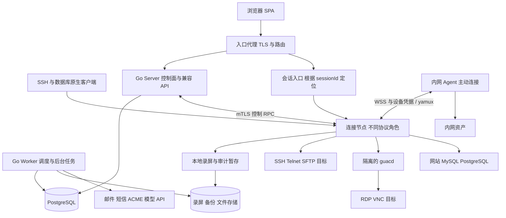

# 后端架构与部署

## 目标与边界

目标是让现有前端接入一个可维护、可审计的独立后端。核心闭环为：创建身份与资产、授予访问权、建立远程会话、记录操作、查询和回放审计。扩展闭环包括网站代理、数据库代理与工单、凭据轮换、身份提供方、通知、AI 工具执行。

系统以一个组织实例为安全边界。部门是授权范围，不是租户。第一版不支持跨实例用户共享，也不通过前端传入 `tenantId` 达成隔离。需要 SaaS 化时，再设计租户主键、复合外键、密钥域和 PostgreSQL RLS，并进行独立安全评审。

## 运行架构



`server` 管理 HTTP 请求和业务事务；`connector` 管理长连接及协议状态；`worker` 管理异步任务。它们共享领域类型和契约，但只由拥有该领域的应用服务更改业务表。连接节点不直接使用业务数据库管理员账号，状态通过经过认证的内部 RPC 上报。

| 进程或角色 | 主要职责 | 状态与扩缩容 |
|---|---|---|
| `nt-server` | 身份、授权、资产、审批、审计查询、配置、API 兼容、会话入口路由 | HTTP 可多副本；权威状态在 PostgreSQL；入口长连接须排空后升级 |
| `nt-connector --role terminal` | SSH/Telnet、SFTP、SSH 原生接入、录屏 | 有状态；以会话为单位分配；禁止迁移正在执行的命令 |
| `nt-connector --role graphics` | Guacamole WebSocket、guacd 生命周期、图形监控 | 有状态；按屏幕分辨率、带宽、编码资源限制并发 |
| `nt-connector --role rdp-native` | 原生 RDP listener、NTICKET 解析、目标认证与会话上报 | FreeRDP 3.32.2 + Go supervisor / 每会话 C worker；W3 基础链路、W4 策略和录像验收，见 [D03](implementation/native-rdp.md) |
| `nt-connector --role web` | Host/SNI 路由、鉴权反代、头与响应改写、流量日志 | 配置快照按 revision 更新；支持长 HTTP/WebSocket 流 |
| `nt-connector --role db` | MySQL/PostgreSQL 协议、认证、语句审计与限制 | 每个客户端连接独立协议状态；禁止跨用户复用事务 |
| `nt-worker` | 录屏上传/转换、备份、轮换、证书、通知、调度、AI 运行 | 按 job kind 分队列和资源配额；可水平扩展 |
| `nt-agent` | 从内网主动连接、探活、受控拨号、WOL | 逐设备身份和短期证书；不接受任意代码下发接口 |
| `nt-migrate` | 有序数据库迁移、校验版本 | 单独运行；先于新 server 启动 |
| `nt` CLI | 账号恢复、锁定、证书、属性、GeoIP、状态与版本 | 复用模块用例；离线应急操作身份和审计单独记录 |
| `guacd` | RDP/VNC 到 Guacamole 协议转换 | 私网访问、资源隔离；浏览器不能直接连接 |

模块化单体让用户、授权、审批、审计和 outbox 可以在一个数据库事务内完成变更。连接与转码隔离，使协议库故障、磁盘阻塞、CPU 峰值不会阻断登录和授权管理。只有出现独立团队或容量边界时，再将控制面模块拆成服务。

## 技术选择

| 关注点 | 选择与理由 |
|---|---|
| 语言与 HTTP | Go，采用实现时仍受支持的稳定版本并固定工具链；`net/http` 路由与中间件，明确读写超时和流式例外 |
| 数据库访问 | PostgreSQL 18 为目标版本；`pgx/v5`、显式 SQL、显式事务；不依赖 ORM 自动变更表结构 |
| 协议连接 | Go SSH 客户端/服务端能力，独立 SFTP 实现；Guacamole 协议桥接 guacd |
| 内部协议 | 版本化 protobuf/gRPC，mTLS；控制 RPC 和字节流分离，不能把屏幕帧当业务事件广播 |
| 异步任务 | PostgreSQL job 表、行锁、租约、outbox；LISTEN/NOTIFY 仅作唤醒，轮询兜底 |
| 文件与录屏 | 开发用持久化本地目录；生产支持 S3 兼容对象存储；WebDAV 作为独立适配器 |
| 配置 | 静态启动配置文件 + 数据库动态配置；环境只传非秘密选项或秘密文件位置 |
| 可观测性 | 结构化日志、Prometheus 格式指标、OpenTelemetry trace；业务审计独立存储 |
| Redis | 可选，用于高吞吐限流/短期缓存；不能成为唯一授权、会话撤销或任务真相 |

`pgx` 提供 PostgreSQL 原生驱动与连接池；图形代理选用 Guacamole 的前端协议与 guacd 分工。参见 [pgx 文档](https://pkg.go.dev/github.com/jackc/pgx/v5) 和 [Guacamole 架构](https://guacamole.apache.org/doc/gug/guacamole-architecture.html)。具体依赖版本在实现时锁定和测试，本方案不依赖浮动 `latest` 镜像。

## Go 模块与依赖方向

具体功能包现按[模块开发规划](module-development-plan.md)的 M01..M18 组织；一个功能模块可以同时向 server、connector 和 worker 注册适配器。进程拆分不改变业务表的唯一所有者。

```text
HTTP/WS/SSE adapters → application services → domain policies
                              ↓ ports
                    PostgreSQL / secrets / jobs / connectors
```

Handler 只负责解析、认证上下文、DTO 转换和 HTTP 错误。Service 负责用例、授权与事务。Repository 只接受类型化查询和数据库事务。协议 Adapter 处理 SSH/Guacamole/DB wire，不决定谁有权访问。只有 SecretStore 可以解密；常规 DTO 和日志拿不到密钥明文。

服务入口显式接收 `Actor`、`RequestContext` 和 `ResourceRef`。Actor 包含用户、认证来源、会话、scope、MFA 强度；不得从 JSON 中接受伪造操作者。Worker 使用“服务身份 + 原始委托人 + 授权快照”，敏感任务开始执行前重新授权。

## 连接分配与生命周期

1. `POST /api/portal/sessions` 验证用户状态、授权有效期、来源策略、MFA、资产启用及并发配额。
2. 一个事务创建 `sessions`，保存连接配置 revision、资产/用户名显示快照、权限快照和 `SessionRequested` outbox。
3. 调度器按协议、网络域、容量、网关可达性选择 connector；用 compare-and-swap 设置 `node_id`、`lease_epoch`、连接预约截止时间。预约失败不返回可用会话。
4. 返回与前端一致的 `ExportSession`。不返回目标主机密码，不把 `sessionId` 当作持有即可访问的凭证。
5. 浏览器携 Cookie 和 sessionId 升级 WebSocket；入口再次验证所有者或分享权限，再按 sessionId 路由到拥有者节点。
6. connector 获取短期、绑定 session/target/epoch 的内部连接授权；按需获取凭据，连接目标并打开录屏。状态回报 `connected`。
7. 用户登出、撤销、过期、空闲或管理员断开触发关闭；先停止输入，关闭目标连接，完成录屏清单，再上报最终状态。

节点以 5 秒心跳、15 秒控制租约作为初始设计值。租约丢失时不得建立新连接；现存会话必须在租约过期前续租或本地关闭。每个连接的本地单调时钟截止时间来自租约剩余时长，不依赖浏览器时钟。分区期间节点自我终止旧 epoch 的 I/O，控制面不能仅因数据库显示离线就让第二节点重接旧会话。

内部 RPC 草案：`ReserveSession`、`ActivateSession`、`DisconnectSession`、`WatchCommands`、`ReportSessionEvents`、`Heartbeat`、`AuthorizeFileOperation`、`IssueCredentialLease`。所有改变操作携带 `request_id/session_id/epoch`，重复调用返回既有结果。跨节点终端字节流采用专门的双向隧道，限制缓冲，不经 outbox。

## 故障与一致性

| 故障 | 定义的行为 |
|---|---|
| API 副本退出 | 新 HTTP 转到其他副本；经该副本中转的 WS 会断开，不承诺透明恢复 |
| connector 退出 | 会话标记 `interrupted`，保留录屏片段；重连产生新会话并重新鉴权，不重放输入 |
| PostgreSQL 不可用 | 拒绝新会话和管理写入；既有会话按最后控制租约到期关闭；审计暂存本地 |
| 对象存储不可用 | 本地持久 spool 缓冲；重试上传；剩余空间低于保留水位时拒绝新会话 |
| 强制审计写入失败 | 停止接受输入并关闭会话；不能静默继续未记录的操作 |
| 任务 Worker 崩溃 | 安全可重试任务在租约到期后重新领取；远程写入结果不明时进入 unknown，不自动重放 |
| 用户或授权被撤销 | 事务提交撤销事件，主动通知 connector；事件丢失由租约复核兜底 |
| 分享令牌泄露或撤销 | 只影响绑定的分享能力；立即失效并断开对应参与者，不影响原会话所有者 |
| Agent 掉线 | 新拨号失败；既有流关闭；重新连接只恢复 Agent 控制通道 |

状态一致性为“业务事务强一致 + 通知与报表最终一致”。审计写入与业务变更同事务；物理录屏与数据库无法跨系统原子提交，通过 manifest、校验和和恢复扫描收敛。

## 部署与网络

开发环境：前端 Vite → `server:8088`，一个 connector，一个 worker，PostgreSQL，guacd 和持久化 spool。部署文档后续生成 Compose，但当前设计不自动启动服务，也不占用现有 8088。

生产最小形态可在一台主机运行隔离容器；这不是高可用部署。高可用形态使用两个以上 server、副本化 connector、独立 Worker 池、具备故障转移的 PostgreSQL、独立对象存储和备份。数据库高可用由平台提供，不能通过运行两个 PostgreSQL 容器代替。

| 网络面 | 暴露规则 |
|---|---|
| HTTPS | 443 对用户开放，承载 SPA/API/WS/SSE；8088 默认仅内部或开发 |
| 内部控制 RPC | 仅服务网络允许，mTLS，按进程身份授权 |
| SSH/数据库/RDP 原生入口 | 单独可配置监听端口，仅对授权网络开放，不能与目标资产端口混淆 |
| guacd | 默认 4822 仅 graphics connector 可达，不能直接暴露到用户网 |
| PostgreSQL | 5432 仅 server/worker/migrate 可达 |
| Agent | 专用 TLS 入口；注册引导令牌不能作为长期设备身份 |
| metrics/debug | 内网管理面，`/api/debug/pprof` 不因存在前端链接就默认开放 |

入口代理保留 WebSocket Upgrade、SSE 无缓冲和长连接超时；仅信任配置的代理来源 IP。网站代理独立域名，避免把目标站点 Cookie、脚本与管理控制台放在同一 origin。静态资源可缓存，登录、API、下载授权及个性化页面禁止公共缓存。

滚动发布采用 expand/contract 数据迁移：先加字段并兼容旧读写，升级控制面和 Worker，再排空 connector，最后清理旧字段。节点上报协议版本和能力，调度器禁止分配到不兼容节点。存在会话的节点停止接收新任务，待会话结束或维护截止才退出。
