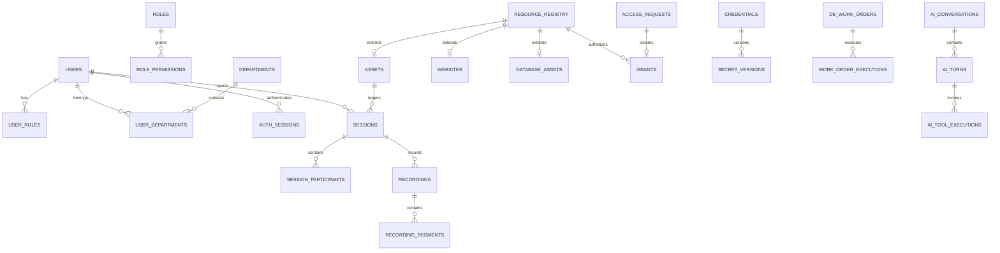

# PostgreSQL 数据模型与一致性

这里定义全业务逻辑模型和关键事务。R01–R04 已生成 31 张表的阶段迁移（含 F00 技术账本），字段范围见 [backend/README.md](../../backend/README.md)；其余模型及后续字段仍待实现。实施时按阶段把约束写成真实 DDL，并用数据库集成测试验证。所有动态类型字段必须有注册表或 schema 校验，不能因为使用 JSONB 就跳过验证。

本文件按数据主题分组，分组不等于模块所有权。124 张表（原 122 张逻辑表 + 迁移技术账本 + R04 主机信任表）的唯一写入模块由 [module-catalog.json](module-catalog.json) 登记，可在[归属索引](module-backlog.md#数据归属索引)查看；跨模块事务遵循[模块开发规划](module-development-plan.md)。

## 存储约定

| 项目 | 约定 |
|---|---|
| 主键 | 服务生成 UUID，HTTP 输出 string；主键不可作为访问凭证 |
| 时间 | 数据库 `timestamptz` 保存 UTC；通常 DTO 输出 Unix 毫秒，字符串时间例外见接口文档 |
| 可变实体 | `id, created_at, updated_at, version bigint`；写入用 version/CAS 或事务锁 |
| 空时间与标识 | 数据库 NULL；DTO 按现有组件转换为 0、空串或缺省，逐字段定义 |
| 状态 | text + CHECK 或服务注册的受限枚举；不能直接接受任意状态 PATCH |
| 密码与令牌 | 登录密码哈希；随机 token 保存摘要；可恢复秘密保存加密 envelope，二者分开 |
| JSONB | 策略快照、供应商设置、协议 attrs、脱敏审计 metadata；关系和核心检索字段不放 JSONB |
| 删除 | 身份/资源先禁用或逻辑删除，审计保留不可变显示快照；外键默认 RESTRICT |
| 分页 | 兼容 current/pageSize 偏移分页；稳定二级排序 id；大审计查询限制时间范围 |
| 组织 | 当前单组织实例，不设置无效的占位 tenant_id |

## 关系概览



## 身份与认证表

F00 另管理迁移技术账本：

| 表 | 关键字段与约束 |
|---|---|
| migration_history | version integer PK、checksum SHA-256、applied_at；启动事务级 advisory lock，校验和漂移阻止启动 |

| 表 | 关键字段与约束 |
|---|---|
| instance_state | singleton key=1；initialized_at、instance_id、schema_version、auth_epoch（恢复/全局撤销递增）；初始化事务锁定此行 |
| users | username、normalized_username UNIQUE、password_hash、nickname、mail、phone、status、type、force_mfa、password_changed_at；type 是受控系统角色，不允许自改 |
| departments | parent_id FK departments、name、sort、version；同父名称唯一，移动时禁止自身/后代作为父节点 |
| department_closure | ancestor_id、descendant_id、depth；PK(ancestor_id,descendant_id)，含 depth=0 自环记录 |
| user_departments | user_id、department_id；复合 PK，FK 均 RESTRICT |
| roles | name UNIQUE、kind、editable、permissions_editable、deletable；内建角色变更受专用规则限制 |
| user_roles | user_id、role_id；复合 PK |
| permissions | action UNIQUE、http_method、route_pattern、menu_key；随版本迁移注册，不能用户任意创建路径 |
| role_permissions | role_id、permission_id；复合 PK；菜单 DTO 从实际允许 action 派生 |
| auth_sessions | token_hash UNIQUE、user_id、phase、mfa_level、issued_at、idle_expires_at、absolute_expires_at、revoked_at、source_ip、user_agent_hash |
| auth_challenges | challenge_hash UNIQUE、kind、purpose、subject_id、auth_session_id、expires_at、attempts、consumed_at、payload_ciphertext/非秘密校验参数 |
| mfa_factors | user_id、kind、secret_ref、enabled_at；TOTP secret 加密；last_accepted_step 原子更新防重放，恢复码独立存储 |
| mfa_recovery_codes | user_id、factor_id、code_hash、batch_id、created_at、consumed_at；码仅签发时展示，消费使用条件 UPDATE；M01 所有 |
| database_passwords | user_id、name、auth_plugin、verifier_format、verifier_ref、pg_scram_verifier_ref 可空、expires_at、revoked_at、last_used_at；M01 所有，协议 verifier 由 M04 加密保护，不与 API token 摘要混用 |
| webauthn_credentials | credential_id UNIQUE、user_id、public_key、sign_count、aaguid、backup flags、transports、last_used_at |
| user_ssh_keys | user_id、fingerprint、public_key、name、last_used_at；UNIQUE(user_id,fingerprint) |
| user_client_certs | user_id、serial UNIQUE、fingerprint UNIQUE、not_before、not_after、revoked_at、last_used_at |
| api_tokens | token_hash UNIQUE、prefix、user_id、name、kind、scope、expires_at、revoked_at、last_used_at；不存完整可用 token |
| login_locks | normalized_subject、source_ip、window_start、failures、locked_until；按策略支持用户与来源维度 |
| user_preferences | user_id PK、access_settings JSONB、ai_preferences JSONB、notification_preferences JSONB；schema 分开校验 |

auth_sessions 索引 `(user_id,revoked_at)`、`(absolute_expires_at)`；挑战清理按 expires_at；登录失败日志不能用用户输入原文无限增长 key，需限长、规范化及限流。

## 外部身份和授权服务器

| 表 | 关键字段与约束 |
|---|---|
| identity_providers | kind、name、enabled、issuer、config JSONB、secret_ref、revision |
| external_identities | provider_id、issuer、subject、user_id、profile_snapshot；UNIQUE(provider_id,issuer,subject) |
| oauth_clients | client_id UNIQUE、secret_hash、redirect_uris、grant_types、scopes、status、access_mode、skip_consent |
| oauth_client_bindings | client_id、user_id 或 department_id；CHECK 恰好一种主体 |
| oauth_authorizations | user_id、client_id、scopes、consented_at、revoked_at；同用户客户端按 scope 版本记录 |
| oauth_auth_codes | code_hash UNIQUE、client_id、user_id、redirect_uri、pkce_challenge、nonce、scope、expires_at、used_at |
| oauth_refresh_tokens | token_hash UNIQUE、family_id、parent_id、user_id、client_id、scope、expires_at、used_at、revoked_at；重用吊销整 family |
| signing_keys | kid UNIQUE、algorithm、public_key、secret_ref、active_from、retire_after；签名私钥独立加密 |

授权码和 refresh token 的消费用 UPDATE WHERE used_at IS NULL RETURNING，不能“先查再改”。OIDC 登录事务的 state/nonce/PKCE verifier 属于 auth_challenges，不放浏览器可篡改的 redirect 参数中。

## 资源、秘密与连接配置

| 表 | 关键字段与约束 |
|---|---|
| resource_registry | id、kind CHECK(asset/website/database/group)、display_name、enabled、deleted_at；为跨类型授权提供真实 FK |
| resource_groups | id FK registry、resource_kind、parent_id、name、sort、default_dial_plan_id；父子类型一致 |
| resource_group_closure | ancestor_id、descendant_id、depth；PK 两端；更新树和 closure 在同事务 |
| assets | id FK registry、protocol、alias、host、port CHECK 1..65535、account_type、username、credential_id、inline_secret_ref、group_id、dial_plan_id、attrs、status、last_access_at |
| database_assets | id FK registry、engine、host、port、database_name、username、credential_id/secret_ref、dial_plan_id、attrs |
| websites | id FK registry、ascii_domain、entrance、target_url、origin_host_mode、dial_plan_id、certificate_id、public_policy、rewrite_rules、secret_ref、access_log_enabled；ascii_domain 唯一且不等于管理 SelfDomain |
| resource_tags | resource_id、tag；PK(resource_id,tag)，tag 长度限制；tag 索引用于过滤 |
| credentials | id、name、kind、username、active_version_id、version；资产引用凭据，不复制明文 |
| secret_versions | id、credential_id 可空、purpose、ciphertext、nonce、wrapped_dek、kek_id、algorithm、aad_version、created_at、retired_at；不可原地覆盖密文 |
| secret_access_events | actor、secret_version_id、purpose、resource_id、request_id、timestamp；不含明文 |
| ssh_known_hosts | asset_id PK、host、port、public_key、fingerprint、version、trusted_by、trusted_at；R04 人工核对的主机信任，端点/版本变化使旧租约失效 |
| dial_plans | id、mode、proxy_id、revision、source_group_id；不可变快照或版本化替换 |
| dial_plan_hops | plan_id、position、gateway_id；PK(plan_id,position)，完整编译后发布 |
| gateways | id、kind CHECK(ssh/agent/group)、name、enabled、revision |
| ssh_gateway_configs | gateway_id FK、host、port、username、credential_id、source_asset_id、host_key_fingerprint |
| agent_gateway_configs | gateway_id FK、device_id UNIQUE、cert_serial 可空、credential_hash、credential_version、previous_credential_hash、previous_expires_at、connection_epoch、protocol_version、version、os、arch、last_heartbeat_at、revoked_at、network_scope；设备API Key摘要与会话epoch见D02 |
| agent_registration_tokens | token_hash UNIQUE、expires_at、max_uses、used_count、allowed_network_scope、revoked_at |
| gateway_group_members | group_gateway_id、member_gateway_id、priority、enabled；PK 两端，禁止 group 环 |
| gateway_group_configs | gateway_id PK、selection_mode CHECK(priority/latency/random) |
| network_proxies | protocol、host、port、username、secret_ref、description |
| node_registry | node_id、role、endpoint、protocol_version、capabilities、capacity、draining、last_seen_at、lease_until |

同一 registry ID 必须只有一个符合 kind 的实体子表记录。创建/删除由 ResourceService 的事务完成；DDL 用 FK 和受控函数/约束触发器保证跨表 kind 一致，普通应用角色禁止绕开写入口。组 ID 同样登记，避免多态 resource_id 没有外键。

凭据内联与引用允许模式由 account_type 决定，CHECK/Service 校验冲突。删除资源保留 registry tombstone，旧审计快照不依赖当前名称。属性和分组变更提高 revision，用于会话重校验。

## 授权与审批

| 表 | 关键字段与约束 |
|---|---|
| grants | user_id 或 department_id、resource_id FK registry、valid_from、expires_at、strategy_id、command_filter_id、source_request_id、revoked_at、revision；主体恰一，expires_at>valid_from |
| strategies | name、upload、download、delete、rename、edit、copy、paste、create_dir、create_file；所有 bool 有明确默认 false |
| command_filters | name、default_action、enabled、revision |
| command_filter_rules | filter_id、priority、match_type、pattern、action、enabled、remark；正则编译/复杂度限制 |
| policy_groups | name、mode CHECK(whitelist/blacklist)、enabled、revision |
| policy_rules | group_id、priority、enabled、action、expires_at、ip_group、time_periods、countries、provinces、cities |
| policy_rule_ip_sets | rule_id、ip_set_id；复合 PK |
| policy_bindings | group_id、user_id 或 department_id；主体恰一，各维度独立部分唯一索引 |
| ip_sets | name、source_type、source_url、secret_headers_ref、rules、refresh_minutes、content_hash、last_synced_at、last_sync_error、enabled |
| approval_scopes | department_id、resource_id；复合 PK；定义可申请资源，不能代替实际访问 grant |
| access_requests | request_no UNIQUE、requester_id、resource_id、reason、status、requested_start_at、duration_minutes、approver_id、approved_start_at、approved_duration、grant_id、closed_reason、version |
| db_work_orders | requester_id、asset_id、database_name、sql_ciphertext/受控正文、sql_hash、request_reason、status、approver_id、approved_at、version |
| work_order_executions | work_order_id、attempt、state、execution_key UNIQUE、target_transaction_ref、rows_affected、error、started_at、finished_at；非确认失败不得创建第二次执行 |

grants 的 source_request_id 非空唯一，确保同一申请只创建一次授权。重复永久授权使用以 user/department 分开的部分唯一索引；过期历史不能依赖含 now() 的动态索引谓词，采用有效状态字段加事务更新或在写入时锁定逻辑授权键。

授权检索索引 `(user_id,resource_id)`、`(department_id,resource_id)`、`(resource_id,revoked_at)`；策略规则 `(group_id,enabled,priority,id)`；审批 `(status,created_at DESC,id)`、`(requester_id,created_at DESC,id)`。

审批核心事务示意：

```sql
BEGIN;
SELECT * FROM access_requests WHERE id = $1 FOR UPDATE;
-- 应用层在事务内确认 pending，校验审批者范围及申请人现有权限。
-- 同时锁定用于判断范围/策略 revision 的必要记录，或提交前检查 revision。
INSERT INTO grants (...) VALUES (...); -- source_request_id UNIQUE
UPDATE access_requests
SET status = 'approved', grant_id = $2, version = version + 1
WHERE id = $1 AND status = 'pending';
INSERT INTO audit_operations (...) VALUES (...);
INSERT INTO outbox_events (...) VALUES (...);
COMMIT;
```

省略号表示待迁移定义的完整列，这段是事务边界说明，不是可直接执行的迁移。reject/cancel 用相同锁顺序。grant 撤销和 request 取消必须原子提交。

## 会话、文件与审计

| 表 | 关键字段与约束 |
|---|---|
| sessions | user_id、asset_id、protocol、access_mode、state、node_id、lease_epoch、lease_until、reservation_expires_at、auth_session_id、policy_revision、policy_snapshot、display_snapshot、connected_at、disconnected_at、close_reason、version |
| session_grant_sources | session_id、grant_id、grant_revision；记录授权来源，撤销时定位受影响会话 |
| session_participants | session_id、user_id 可空、share_id 可空、role、connection_id UNIQUE、joined_at、left_at、source_ip；anonymous share 与正式用户区分 |
| session_shares | session_id、token_hash UNIQUE、passcode_hash、expires_at、readonly、max_participants、created_by、revoked_at、revision |
| client_tickets | token_hash UNIQUE、kind、user_id、resource_id、session_id、expires_at、consumed_at、issued_auth_session_id、auth_epoch、entry、policy_revision；RDP 票据与其他 kind 隔离；ticket ID + secret 摘要，默认 300 秒，解析成功原子消费；数据库专用密码另表 |
| filesystem_mounts | id、session_id 可空、storage_id 可空、owner_id、node_id、root_path、policy_snapshot、expires_at；挂载种类决定字段约束 |
| upload_tasks | id、mount_id、owner_id、directory、filename、target_path、state、expected_size、received_bytes、written_bytes、temp_key、sha256、error、deadline、version |
| storages | name、owner_id、is_shared、is_default、limit_bytes、used_bytes、reserved_bytes、root_key；默认项按适用范围唯一 |
| storage_acl | storage_id、user_id/department_id、capabilities；主体恰一 |
| snippets | owner_id 可空、scope、name、content、description；系统与个人脚本分开授权 |
| recordings | session_id、kind CHECK(terminal/guacamole/video)、storage_type、object_key、status、size、sha256、convert_state、upload_state、error、retention_until、legal_hold |
| recording_segments | recording_id、sequence、object_key、size、sha256、start_offset_ms、end_offset_ms、uploaded_at；PK(recording_id,sequence) |
| audit_logins | occurred_at、actor_id 可空、account_snapshot、source_ip、method、result、reason_code、trace_id |
| audit_operations | occurred_at、actor_id、action、resource_type/id、before_redacted、after_redacted、result、trace_id、request_id |
| asset_access_logs | occurred_at、actor_id 可空、resource_id、session_id 可空、access_mode、source_ip、result、reason_code、policy_revision、trace_id、display_snapshot；M08 所有，建连前失败也记入 |
| audit_commands | occurred_at、session_id、actor_id、command、risk、result_ref、exit_code、duration_ms、source_type |
| audit_files | occurred_at、mount_id、session_id、actor_id、action、path、bytes、result、trace_id |
| database_sql_logs | occurred_at、db_connection_id、asset_id、actor_id、database_name、statement_hash、sql_redacted、protected_sql_ref、source_type(proxy/work_order)、work_order_id 可空、client_ip、duration_ms、rows、result |
| website_access_logs | occurred_at、website_id、actor_id 可空、request_id、method、path_redacted、status、duration_ms、bytes_in/out、source_ip |

会话在线查询用 `(state,node_id)` 与 `(user_id,state)`；历史 `(disconnected_at DESC,id)`；录屏 `(session_id,kind)`；任务 `(owner_id,mount_id,created_at)`。按日/月分区的大审计表，其 PK/唯一约束须包含分区键；不能在 PostgreSQL 分区表上假定 id 单列全局唯一约束自动成立。

审计事件若有全局去重需求，另建小型 `audit_event_receipts(event_id PK, occurred_at)`，在同一事务写 receipt 和分区事件，保留时同步清理。热点排序索引使用 B-tree，纯时间扫描可用 BRIN；是否分区以真实数据量决定，首版不为几十条记录建立数百分区。

录屏文件键只用内部 ID，不用用户文件名或任意 URL。会话引用已删除用户/资产时读取 display_snapshot，不能把历史主体名称改成新的同名用户。

## 网站、数据库和证书扩展

| 表 | 关键字段与约束 |
|---|---|
| website_temp_allows | website_id、normalized_ip、granted_by、expires_at、max_expires_at；UNIQUE(website_id,normalized_ip) |
| website_access_sessions | token_hash、website_id、actor_id 可空、public_grant_revision、expires_at、revoked_at；与控制台会话分开 |
| db_connections | id、actor_id、asset_id、node_id、state、auth_method、opened_at、closed_at、policy_revision |
| certificates | name、common_name、chain_pem、公钥指纹、secret_ref、not_before、not_after、issuer、kind、is_default、issued_status |
| certificate_orders | certificate_id、acme_order_url、challenge_state、job_id、attempt、error、started_at、finished_at |
| dns_providers | name、provider_type、public_config、secret_ref |
| certificate_dns_bindings | certificate_id、dns_provider_id；复合 PK |
| certificate_revocations | serial UNIQUE、revoked_at、reason、issuer_key_id |

网站域名用 IDNA 规范化并保留展示值。活动入口 `(ascii_domain, entrance)` 唯一。证书默认项采用 `UNIQUE ... WHERE is_default AND active` 的实际状态谓词，切换在一个事务中完成。

## 任务、运维、通知与 AI

| 表 | 关键字段与约束 |
|---|---|
| schedules | name、kind、cron、timezone、payload_ref、enabled、overlap_policy、misfire_policy、next_run_at |
| scheduled_runs | schedule_id、scheduled_for、job_id；UNIQUE(schedule_id,scheduled_for) |
| jobs | kind、payload、idempotency_key、state、available_at、attempts、max_attempts、owner_id、lease_until、lease_epoch、cancel_requested、result_ref、error |
| job_runs | job_id、attempt、node_id、started_at、finished_at、result、error；UNIQUE(job_id,attempt) |
| outbox_events | event_id PK、aggregate_type/id、aggregate_version、event_type、payload、occurred_at、published_at |
| event_deliveries | event_id、consumer、state、next_attempt_at、attempts、lease_until；PK(event_id,consumer) |
| idempotency_records | actor_id、route_id、idempotency_key、request_hash、state、response_status、resource_id、response_redacted、expires_at；PK(actor_id,route_id,idempotency_key) |
| rotation_policies | name、scope_type、schedule_id、rotate_type、password_rules、keep_old_key、enabled |
| rotation_policy_targets | policy_id、resource_id/credential_id；按 scope_type 校验且实体 FK |
| rotation_runs | policy_id、credential_id、trigger、initiator_id、state、candidate_version_id、started_at、finished_at |
| rotation_targets | run_id、asset_id、old_version_id、candidate_version_id、state、error；PK(run_id,asset_id) |
| settings | key PK、typed_value JSONB、secret_ref 可空、revision、updated_by；类型由注册表定义 |
| settings_revisions | revision PK、changed_keys、actor_id、created_at、status |
| settings_node_acks | revision、node_id、status、error；PK(revision,node_id) |
| backup_files | name UNIQUE、object_key、size、checksum、app_version、schema_version、db_version、includes、excludes、created_at |
| backup_tasks | job_id UNIQUE、type、source、file_id、status、started_at、finished_at、message |
| geodata_versions | content_hash UNIQUE、object_key、build_time、active、verified_at；active 部分唯一 |
| monitor_rules | id、metric、agent_id、threshold、recovery、hold_seconds、enabled、version、pending_at、firing、sample_state、checked_at、deleted_at |
| system_events | id、rule_id、rule_name、metric、kind(firing/recovered/cancelled)、value、created_at、acknowledged_at、acknowledged_by |
| notification_channels | type UNIQUE、enabled、public_config、secret_ref、revision |
| notification_bindings | user_id、channel_id、address、verified_at、enabled；PK(user_id,channel_id) |
| notification_rules | name、events、conditions、channels、target_mode、recipient_ids、quiet_minutes、enabled |
| notification_deliveries | event_id、rule_id、channel_id、recipient_key、state、attempts、next_retry_at、sent_at、redacted_response；组合 UNIQUE |
| ai_profiles | name、api_type、base_url、secret_ref、models、limits、request_options、enabled |
| ai_conversations | user_id、scope_type、title、model、active_branch、schema_version、created_at、updated_at |
| ai_messages | conversation_id、branch_id、sequence、role、content_ref、client_message_id、created_at；用户消息的 (conversation_id,client_message_id) 部分唯一 |
| ai_turns | conversation_id、branch_id、trigger_message_id、state、model、usage、cancel_requested、version；每会话至多一个活动轮次 |
| ai_events | conversation_id、sequence、turn_id、event_type、payload、created_at；PK(conversation_id,sequence) |
| ai_tool_executions | execution_id PK、turn_id、tool_name、arguments_hash、arguments_redacted、target_resource_id、state、approval_id、execution_key UNIQUE、result_ref |
| ai_tool_approvals | execution_id、actor_id、decision、arguments_hash、target_revision、expires_at、reason、created_at；决定不可静默覆盖 |
| ai_usage_ledger | turn_id、provider_request_id、input/output/cache tokens、estimated_cost、currency、price_revision；计费重试可去重 |
| entitlement_licenses | schema70：revision PK、instance_id、license_id、token、digest、actor_id、created_at；应用仅追加历史，普通 API 不返回 token；公钥不存入业务表 |
| entitlement_head | schema70：singleton=1、revision FK；导入按当前 revision 锁定更新；local 模式读取只读部署文件，不读取此表覆盖本地模式 |
| branding | singleton key、system_name、copyright、version、logo_id、links |
| logo_assets | id、object_key、mime、size、sha256、created_by |

这些表可按阶段分多次迁移，不要求首个迭代全部创建。API 对外的 SystemEvent、RotationLog 等可以由这些核心记录投影，不应再维护一份含义相同但不一致的影子状态。

## 任务领取与幂等

以下为列名已定义的任务领取示例；参数分别为节点、领取上限和租约秒数。执行本身必须在事务提交之后，不持有数据库行锁等待外部系统：

```sql
WITH picked AS (
  SELECT id FROM jobs
  WHERE state = 'pending' AND available_at <= now()
  ORDER BY available_at, id
  FOR UPDATE SKIP LOCKED
  LIMIT $2
)
UPDATE jobs j
SET state = 'running', owner_id = $1,
    lease_until = now() + ($3 * interval '1 second'),
    lease_epoch = j.lease_epoch + 1,
    attempts = j.attempts + 1
FROM picked WHERE j.id = picked.id
RETURNING j.*;
```

完成更新必须带 `id + owner_id + lease_epoch + state=running`，防止失去租约的 Worker 覆盖新结果。Heartbeat 不能无限续租已 cancel 的任务。Sweeper 根据任务类型处理超时：通知/对象上传等安全幂等任务回 pending；远程 SQL/命令/轮换结果不明的任务置 needs_reconcile，不自动回 pending。

`SKIP LOCKED` 用于队列竞争，不能用于授权读取，因为它会跳过锁定记录并产生不完整视图。[PostgreSQL SELECT 文档](https://www.postgresql.org/docs/current/sql-select.html) 说明了相关语义。

HTTP 幂等记录采用 `(actor_id, route_id, idempotency_key)` 唯一，保存请求 hash、状态码、资源 ID、脱敏响应和截止时间。同键不同正文返回 409；不要为了幂等保存含明文密钥的响应。前端未发送 Key 的调用不能声称具备自动去重，审批和票据消费另以业务唯一约束保证。

## 保留、恢复和迁移

初始建议值为设计默认：挑战 5 分钟、连接预约 30 秒、短期客户端票据 60 秒、审计 180 天、录屏 30 天、失败 job 30 天。每种数据必须单独可配置；这些值不是现有产品承诺。

清理顺序：检查保留/法律保留 → 记录删除意图 → 删除对象并确认 → 清理片段和元数据 → 留下必要删除审计。定期反向扫描孤立对象、缺失对象和未完成上传。数据库备份与对象生命周期策略必须协调，避免数据库恢复到仍引用已过早删除的录屏。

备份恢复需包含 schema migration 版本和密钥引用。上线前验证空库迁移、上一版本升级、迁移锁、失败恢复和真实备份恢复。数据库 schema 回退不能靠盲目执行 down migration 删除生产数据，优先兼容前滚修复。

## 使用文档补充约束

- 主机别名使用 `^[A-Za-z][A-Za-z0-9_-]*$`；非空别名在实例内唯一。名称回退只允许唯一已授权匹配；重名不靠数据库排序取第一条。
- 数据库名称作为原生路由输入有歧义时拒绝；新建/改名预检查代理兼容性。`database_passwords` 对外适配个人中心 `type=database` 令牌视图；MySQL 采用 TLS 上 caching_sha2_password 完整认证，以 Argon2id PHC 验证个人数据库密码；PG扩展另存SCRAM verifier，详见 [D07](implementation/database-auth.md)，不使用API token摘要校验scramble。
- `website_temp_allows` 记录 website_id、source_ip、issued_by、expires_at、absolute_expires_at、auto_renew、revoked_at、last_access_at；续期条件更新，不能让撤销记录复活。分享链接 token 与激活后的 IP 允许记录分开，激活次数与复用规则在 API 契约中确定。
- `sessions` 增加入口能力快照 capability_snapshot，能力来自实际适配器与策略交集。策略变化重新评估，不把历史快照当永久授权。
- `assets.attrs` 按 SSH/RDP/VNC/Telnet 分 schema，禁止无约束透传到 guacd；RemoteApp、PDU、环境变量和 WOL 参数分别校验。
- `storages.limit_bytes` 为权威配额，UI 的 GB 与系统属性的 Byte 在适配层转换；预留/已用计数覆盖浏览器上传和驱动器写入。
- `backup_files` 清单记录 format_version、server_major、client_major、schema_version、CA/KEK 依赖、included/excluded 对象和校验值；`backup_tasks` 区分备份、复制和恢复状态。官方 .ntbak 格式互通尚未确认。
- 设置仍由 M18 唯一写入，103 个 property 键的业务校验 owner 见 [属性目录](system-property-catalog.md)；不能按业务 owner 另建一份独立配置真相。
