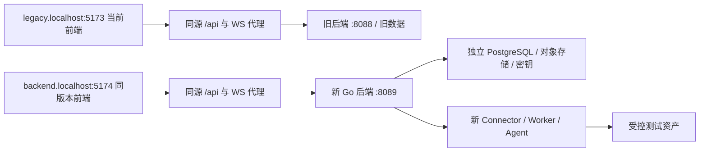

# 前端逐轮接入新后端的开发与执行计划

基线日期：2026-10-27。目标：沿用当前 React 前端，每轮交付一组真实业务闭环，由用户在新环境操作验收，最终独立替换现有后端。保留 Go + PostgreSQL、F00/M01–M18 和 D01–D07 技术决策。本计划的 R00–R17 是**用户验收顺序**，W0–W4 仍是模块建设批次；一个模块可以在多轮扩展。

每轮详细交付、操作步骤与失败用例见[逐轮执行卡](migration-rounds.md)，机器源为[migration-rounds.json](migration-rounds.json)。R01 已实现初始化、登录与可用首页，运行方法见 [backend/README.md](../../backend/README.md)；R02 已接受；R03 资产、凭据与授权目录已接受；R04 SSH 终端与在线审计已接受；R05 文件操作与回放已开发，待用户验收；R06 已完成开发与自测，待用户验收；R07 开发中（首阶段 Telnet），R08 及之后待开发。开发自测与用户验收分别记录，以执行卡和验收记录为准。

## 迁移方式：两个环境，一套前端，逐轮增加真实能力



新环境的所有接口、上传、下载、WebSocket、回放和鉴权都来自新后端。未实现功能明确显示“本轮未开放”，服务端拒绝调用；不对404/501做旧后端自动回退。旧环境用于基准比对和未迁移业务正常运行。新旧系统不共享会话Cookie、数据库写入、任务调度或密钥目录。

此选择避开三个实际问题：新旧资产ID未必相同；登录会话和一次性票据不能互认；同一次会话的HTTP/WS/文件/录像必须由同一后端拥有。后续按用户/资产分批迁移是**迁移业务所有权**，不是前端按API前缀拼接两个系统。

验收账号和测试资产可以两边分别创建，但新系统不得自动同步对生产资产的轮换、SQL写入、定时任务或通知。所有写副作用只指定一个执行系统。

## 本轮已经提供的前端配置

在仓库根目录两个终端分别运行：

```powershell
npm run dev:legacy
npm run dev:backend
```

| 环境 | 必须访问的前端地址 | 默认API目标 | 可覆盖变量 |
|---|---|---|---|
| 旧后端对照 | `http://legacy.localhost:5173` | `http://localhost:8088` | LEGACY_API_TARGET |
| 新后端验收 | `http://backend.localhost:5174` | `http://127.0.0.1:8089` | BACKEND_API_TARGET |

默认不需要复制配置文件。需要调整目标时，将 [.env.legacy.example](../../.env.legacy.example) 或 [.env.backend.example](../../.env.backend.example) 复制为相应 `.env.*.local` 后修改并重启Vite。模板不包含凭据；目标仅接受HTTP(S)根origin。环境变量只在Node代理侧读取，不写入客户端JavaScript。原 `npm run dev` 及 DEV_API_TARGET 仍可用；两个专用mode刻意忽略共享DEV_API_TARGET，避免误连。

开发页面右下角显示 NEW BACKEND/LEGACY；`/__migration/profile` 显示配置目标，**不代表后端健康或身份已验证**。新后端未启动时502/代理连接失败是预期表现，不应伪造数据。服务器绑定127.0.0.1，固定端口被占用时退出；不能悄悄换端口导致OAuth回调与验收链接变化。

Cookie按主机而非端口隔离，因此不能仅用localhost的两个端口当作两套登录态。两个mode拒绝通过错误主机打开；代理只在验证mode移除Set-Cookie的Domain，保留HttpOnly/SameSite/Secure。Chromium通常能解析`.localhost`；若本机解析失败，管理员可在hosts中加入 `127.0.0.1 legacy.localhost backend.localhost`，本次不自动修改系统hosts。[Cookie作用域](https://developer.mozilla.org/en-US/docs/Web/HTTP/Guides/Cookies)、[Vite开发服务器](https://vite.dev/config/server-options)

代理保留浏览器Origin，不能通过关闭CSRF/WS来源检查让联调“通过”。新后端development配置显式允许 `http://backend.localhost:5174`，cookie为host-only，开发环境可不用Secure；生产必须HTTPS及Secure。Passkey/mTLS/OIDC安全行为在R13使用可信HTTPS测试域名单独验收，HTTP验证环境不能替代。旧系统若限制Origin，应为验证域配置允许列表；做不到则用现有旧站点对照，不能改代理伪造Origin绕过限制。

## R01 首先解决前端能否启动

当前 `LicenseProvider` 会阻塞所有受保护页面，`RedirectPage` 固定跳 dashboard/x-asset，`ManagerLayout` 挂载账号及监控查询。因此第一轮不能只写登录接口。

| 接口/契约 | R01交付行为 |
|---|---|
| GET `/api/branding`、`/api/logo` | 真实品牌/版本，logo合法图片，初始化前可用 |
| GET `/api/setup-status`、POST `/api/setup-user` | 一次初始化、并发只一个成功；不使用虚构管理员 |
| GET `/api/login-status`、POST `/api/login`、POST `/api/logout` | 保持现有状态字符串/DTO，Cookie会话真实持久化，退出204 |
| GET `/api/account/info` | 真实用户信息、类型、菜单/权限；字段以account-api.ts为准 |
| GET `/api/license` | 自有local provider投影；不伪造官方enterprise授权来解锁所有菜单 |
| GET `/api/system/runtime`（新增） | `{backendId,instanceId,release,contractVersion,schemaVersion,capabilitiesRevision}`，登录后可读 |
| GET `/api/system/capabilities`（新增） | 能力粒度到操作/入口，具体结构见下节 |
| 登录后首页 | R01新增轻量“联调首页”：真实实例版本、已开放能力及入口；不提前触发尚未实现的dashboard聚合请求 |
| 错误语义 | 未初始化沿用418；未登录401；权限403；未实现501；暂不可用503；不能用401表示功能未开放 |

branding等公开响应不返回数据库DSN/节点秘密。旧错误对象的code为数字，业务code映射必须沿用现有 ApiError，扩展字符串用独立reason字段；不能把字符串code传进Number后全部变成0。新客户端版本化API的字符串code与旧API兼容适配分开。

R01登录表单若开启验证码，需同时实现真实captcha生成/校验；或者显式development profile关闭并返回captchaEnabled=false，R02上线前完成验证码/锁定/MFA。初始化、账号会话和菜单必须真实，禁止以mock支撑“完成登录”。

## 前端适配必须与每轮后端一起交付

R01新增 `BackendRuntimeProvider` 和 `CapabilityGate`，只在新后端模式启用新的发现流程；旧模式保持现有license/权限逻辑。生产切换后新模式成为标准默认，R17移除临时legacy分支。mode用于开发配置，不能作为服务端授权依据。

新能力响应示例（设计结构；当前实现以 runtime/capabilities 和 OpenAPI 为准）：

```json
{
  "schemaVersion":1,
  "revision":3,
  "backendId":"nt-go",
  "features":{
    "identity.users":{"state":"available","reason":null},
    "session.ssh":{"state":"not_implemented","reason":"planned_round_R04"},
    "session.rdp.native":{"state":"not_configured","reason":"certificate_required"}
  }
}
```

state固定 `available/not_implemented/not_configured/not_entitled/unavailable`。用户可操作=服务端可用能力∩账号权限；服务端最终鉴权。未知能力默认关闭，发现请求失败显示错误并可重试，不能当成全部支持。menu只解决可见性，还要route guard处理深链接、query.enabled阻止后台查询、action guard限制按钮和WS启动。权限变更/实例切换清空React Query缓存和permission单例、关闭所有WS后重新登录；不得仅改变baseURL继续沿用旧缓存。

| 代码位置 | 适配内容 | 轮次 |
|---|---|---|
| vite.config.ts / scripts/frontend-backend-profile.ts | 两种隔离代理mode、环境标识、固定端口 | R00本轮已完成 |
| src/hook/LicenseContext.tsx / src/api/license-api.ts | 新能力上下文与旧许可证展示分开，消除“高级版=全部能力”假设 | R01 |
| src/App.tsx / layout/RedirectPage.tsx / hooks/use-filtered-menus.ts | 联调首页、路由/菜单守卫，移动端默认页也遵守能力 | R01–R02 |
| src/layout/ManagerLayout.tsx / use-global-monitor-status.tsx | 未开放监控/统计时禁用轮询，无401/501弹窗循环 | R01；R06/R16启用 |
| src/api/core/requests.ts / api-error.ts | 保持直接JSON、204、数字code；新reason和requestId仅用于提示/诊断 | R01 |
| account-api.ts / 各业务API | DTO兼容、未开放子页query gate，不用any掩盖字段冲突 | 对应轮次 |
| AccessTerminal / Guacamole / AI / upload/download | WS与HTTP同后端，协议帧/附件响应分别验收 | R04–R15 |
| 原生RDP回放 | 已有VideoPlayback页面，优先复用；按新manifest/Range补适配，不能重复造页面 | R14 |
| 联调验收报告 | 记录真实backendId和请求证据；禁止只根据环境角标判定连接正确 | 每轮 |

API契约台账应从现有 [前端接口清单](frontend-contract-inventory.md) 精化：每行固定 `method,pathTemplate,operationId,module,round,frontendConsumers,status,evidence`，把继承CRUD候选与真实调用分开。每轮只宣称已实际使用/测试的操作；未用候选标not_used，不为清零而实现无权限接口。HTTP契约保存在各模块OpenAPI，WS/SSE帧单独schema。R17要求所有实际页面触发的请求都有归属，无unknown项。

## 每轮重复使用的执行流程

1. **冻结切片**：从执行卡选择本轮；对照上一轮验收记录，列接口/页面/真实目标及故障场景。新增依赖必须加入同轮或前置轮，不能用假实现藏依赖。
2. **开发后端**：提交领域服务、迁移、API/协议适配、审计、状态机及自动化测试；每轮都有可运行部署，Connector/Worker按需要启用。
3. **适配前端**：实现本轮字段和能力gate；菜单显示当前支持项，未完成操作解释原因。页面表单与新后端校验一致，不掩盖服务端错误。
4. **自动验证**：模块集成/契约测试 → 前端类型/现有HTTP回归 → HTTP/WS代理回归 → 本轮端到端。迁移脚本跑升级及失败中断恢复；不能用前端build替代后端测试。
5. **部署候选版本**：输出前后端commit、镜像digest、schemaVersion、能力revision；升级新测试环境，按fixture ID幂等补测试数据，不重置用户之前的验收记录。
6. **交给用户操作**：给固定链接、账号获取方式、1–6步点击流程、预期结果与一个反例。密码通过受控渠道或初始化创建，不写进文档/git。你按执行卡验证，无需手写HTTP请求。
7. **记录结果**：记录passed/failed/not_run、证据、问题ID。失败修复后重测本轮与受影响前轮；用户未操作不能自动标user_accepted。
8. **推进**：自动测试通过、用户验收通过、没有阻断缺陷才能标round accepted。下一轮沿用已验收数据，不以新功能覆盖旧缺陷。

每轮不是只交“后端代码”：必须交启动/升级命令、可打开的前端、测试账号与资产说明、实际接口台账、可复现点击清单、自动测试结果和回退说明。后端命令在实现前只能作为约定，不能在当前仓库声称 `docker compose up` 已可运行。

## 数据、测试资产和副作用

R01初始化管理员；R02创建 `accept-admin/operator/reviewer/denied` 四类主体（不固定密码）、两个部门和不同权限；R03建立 SSH A/B、Windows RDP、VNC、Telnet、Web、MySQL、PG 和不可达目标的fixture清单。每种未开发协议可以登记测试设备信息，不提前宣称资产服务已经支持。真实Windows/RDS、邮件测试收件箱、身份提供方、TLS域名分别在相关轮次准备；未提供则该专项not_run，不能用截图或mock填passed。

fixture用稳定外部键如 `acceptance:ssh-a` 进行幂等创建，服务端分配ID；禁止把旧库ID直接拷进新库。数据导入分导出/暂存DTO/映射/dry-run/引用校验/导入/抽验，遵循D04。轮换、备份恢复、写SQL、邮件、SMS和AI付费调用只在专用测试资产或明确授权环境执行。

每轮回归必须保留 R01 登录/退出、R02 越权、R03 授权目录；R04之后增加SSH连接/撤权，R05之后增加文件/录像。数据库迁移会影响历史轮次时升级前备份；不允许修改已经发布的SQL迁移文件。

## 全新生产部署（R17，2026-11-12范围更新）

用户明确选择全新部署，不考虑迁移旧数据。本节替代原R17旧系统迁移与切换流程；R00–R16记录保留为开发历史。旧数据导出、ID映射、差异迁移、旧历史/凭据/录屏导入、旧系统停写与归档均不在本轮范围。不将开发验收库复制为生产库。新系统自身的数据库版本升级、备份恢复和升级回退仍必须验证。

| 阶段 | 交付与操作 | 放行条件 |
|---|---|---|
| R17-A生产发布包 | 固定镜像、生产配置、静态前端、域名/TLS反代、环境预检查、安装升级命令；去除开发挂载及测试服务 | 在干净环境可重复安装；HTTP/WS/SSE及启用协议入口可用 |
| R17-B初始化与保障 | 空库初始化管理员和权限；配置生产密钥、资产、证书、通知、Agent、持久化及备份 | 重复初始化不覆盖数据；秘密不泄露；备份和隔离恢复通过 |
| R17-C试运行 | 新建少量生产用户和资产，核对连接/文件/录屏/审计/撤权；测量并发、磁盘和MP4资源 | 阻断缺陷为0；告警有效；按实际容量测得恢复目标；升级回退流程可用 |
| R17-D正式上线 | 按首发范围开放入口、观察运行、交付运维手册和验收包 | 独立运行、关键指标正常、用户签收 |

入口包含Web/API、终端WS、启用的SSH/RDP与数据库代理、Agent endpoint、身份回调和网站域名。使用正式地址与可信证书；不预设所有协议都必须对公网开放。前端、API及相关组件配套发布，生产无旧后端fallback或联调角标。

备份需包含新系统数据库、文件/录屏及恢复所需密钥；密钥独立保管。生产数据库版本升级仍使用迁移机制，不能因为不迁移旧数据而跳过。升级前备份、必要时排空会话；已产生新写入时，回退须核对数据库兼容性和数据保留，不能简单更换旧镜像。

## 全新生产上线签收标准

- 首发启用功能及排除项明确。DBeaver依用户要求免测关闭；Passkey实机、RemoteApp及R14暂缓项沿用既定范围，不自动重新要求测试，也不宣称已实现未完成能力。
- 干净环境安装和首次初始化通过，生产账号/权限/证书/密钥独立配置，无验收账号及测试夹具依赖。
- 已启用页面、按钮、API和协议入口可用，越权、撤权、重复提交及故障恢复通过；前端全部请求只到新系统。
- 持久化、备份、隔离恢复、资源限制、磁盘与服务告警按实际生产环境验证，恢复时间和可接受数据损失有实测依据。
- 小范围试运行、发布观察与运维交付完成，用户最终签收；不要求旧系统导出、迁移或归档。

验证工具：`npm run docs:migration` 检查轮次依赖、模块/需求覆盖、页面/源码引用并生成执行卡；`npm run test:migration-proxy` 检查真实Vite HTTP/WS转发行为。两者均不代表后端业务已实现。
