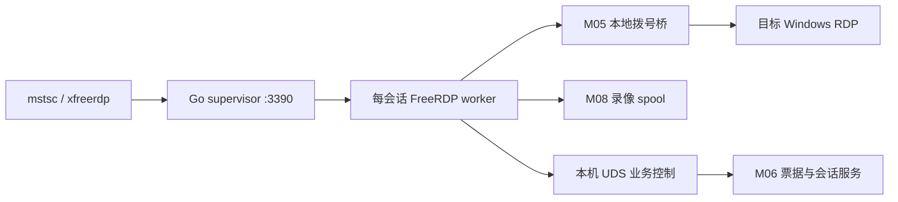

# D03 原生 RDP 代理开发规范

2026-11-03 已在开发环境接通强制录屏的只读桌面。平台收到首帧后登记连接，容量超限或撤权会关闭目标连接。客户端画面与 MP4 像素对照、错误密码和活动会话撤权均已通过隔离 NLA 目标验收。Windows 实机、浏览器鉴权回放和正式部署仍在剩余清单中。[R14 验收记录](../acceptance/R14.md)

主责 M06；协作 M05 拨号、M04 凭据、M07 文件、M08 录屏、M13 证书。关联 U11/U14/U15。采用 **FreeRDP 3.32.2 + 自有代理插件/补丁 + Go supervisor**。不是直接运行上游代理就能满足全部业务，也不是将 RD Gateway HTTP 隧道视为可审计的 RDP 中间代理。

本次 R14 的 RemoteApp 已按用户要求跳过；下文扩展规划不作为本次交付或验收门槛。

## 进程与通信

首个生产 profile 为 Linux amd64 侧车，客户端可 Windows/Linux。Go 接受 TCP 后，使用 `exec.Cmd.ExtraFiles` 把已连接 socket 传给单会话 worker；worker 调用固定版本 `pf_server_start_with_peer_socket`。上游接口在 [3.32.2 pf_server.c](https://github.com/FreeRDP/FreeRDP/blob/3.32.2/server/proxy/pf_server.c) 可查，构建时链接固定代理源码；它不是承诺永久稳定的公共 ABI。

worker 通过权限0700目录下 UDS 请求业务服务，服务端校验 peer UID、worker PID 和启动时通过私有 pipe 传入的一次性 worker nonce。每个 worker 只处理一会话，nonce 绑定启动 ID；秘密不进入 argv/env/配置文件。进程非 root，read-only rootfs、禁 host network 任意访问，只有拨号桥和 spool 可用。限制并发、FD、CPU/RAM；首轮测试限额为每 worker1 GiB、2 vCPU，再按实测调整，不能据此推定可用并发。

Go supervisor 管理 `starting → authenticating → connecting → active → draining → closed/failed`。启动10秒、票据解析30秒、目标连接15秒超时；SIGTERM 后5秒仍未退出则 SIGKILL。worker 崩溃关闭客户端、结束会话并保存不完整录像标记，不自动重放票据。

## 票据和两段认证

前端继续申请 `NTICKET:<ticketId>:<secret>`，默认300秒（60–3600）。`.rdp` 的 username 带票据；密码留空。前端到代理仅 TLS，不使用 NLA；必须验证代理证书，不能关闭加密。代理到目标使用 NLA/CredSSP 和 M04 租约凭据。若企业策略强制客户端侧 NLA，这个 profile 返回不支持，不偷偷退回弱安全设置。

固定 3.32.2 的 TLS `ServerPeerLogon` 在 ClientInfo 之前执行，没有提交用户名，只能检查入口传输模式，不能作为票据认证。实际关卡位于 `ServerFetchTargetAddr`：从 ClientInfo 读取票据，严格解析前缀、长度与编码，再通过 UDS `ConsumeTicket` 做数据库原子消费；失效/已用/撤权均拒绝。消费绑定 session、resource、actor、worker 及当前授权/版本校验。两处客户端连接 hook 再次检查已消费、已准备状态，先完成票据认证再申请秘密及目标桥，不允许客户端指定目标主机。真实 FreeRDP 客户端的负面测试已验证错误/撤销票据无目标拨号。上游扩展点见 [proxy_modules_api.h](https://github.com/FreeRDP/FreeRDP/blob/3.32.2/include/freerdp/server/proxy/proxy_modules_api.h)。

自有内部 UDS 方法（Connected / AppendAudit 和录像清单仍待实现）：

| 方法 | 入参 | 返回与约束 |
|---|---|---|
| ConsumeTicket | id、method、ticket | sessionId、leaseUntil；一次消费，不回退；来源 IP 和 worker 身份取自已验证连接 |
| PrepareTarget | id、method | payload：socketPath、serverName、certificateFingerprint、username、password、security、通道子集；单次调用，仅内存交付 |
| RenewSession | id、method | leaseUntil；当前每2秒续租、10秒租约，传输层拒绝超过15秒的返回值 |
| Connected / AppendAudit | 待实现 | 完整桌面状态和连续审计；不包含密码/票据 |
| Finalize | id、method | 当前幂等中断收尾；完整 profile 后续增加受验证的录像清单 |

nonce 仅在 bootstrap 首个固定32字节握手中传递，之后是4字节大端长度的 JSON 帧。会话 ID 由控制连接绑定，不接受 worker 在后续请求中指定或切换会话。

M05 将 SSH 跳板/Agent 等链路映射到本机一次性拨号桥。FreeRDP 必须按原目标 hostname 校验证书，不能因为 socket 连127.0.0.1就跳过校验；采用配置的 CA 或管理员确认的目标证书指纹，指纹变化需审批。使用 `ClientX509Certificate`/目标验证适配进行校验，不能 `accept-all`。[FreeRDP 3.32.0](https://www.freerdp.com/2026/09/23/3_32_0-release) 已将代理目标证书默认策略改为未明确接受即拒绝，部署配置必须显式匹配此行为。

## 通道策略不能只写进 .rdp 文件

启动 worker 时计算 effective capabilities；强制加载授权/策略/录像插件，RequiredPlugins 缺失直接拒绝启动。静态和动态通道均白名单，未知通道拒绝，禁止全量透传 `drdynvc` 绕过检查。使用 FreeRDP 通道回调重组分片，按最大长度和 state machine 处理；策略不可实施时拒绝连接。

| 能力 | 首个完整桌面 profile | 后续开发与可发布条件 |
|---|---|---|
| 键盘/鼠标只读 | 输入事件在代理端丢弃并审计，不靠客户端设置 | 粘贴属于输入，也必须拒绝 |
| 剪贴板完全禁用 | 禁止 cliprdr | 客户端伪造声明仍不能传输 |
| 文本双向剪贴板 | 实现 cliprdr 文本格式白名单、限制1 MiB，禁文件/自定义格式 | 不能只打开 Clipboard 总开关即称文本隔离已完成 |
| 单向复制/粘贴 | 首版 capability=false | 解析 FORMAT_LIST / DATA_REQUEST / DATA_RESPONSE 的双方状态；正向合法、逆向伪造及分片矩阵通过才开启 |
| 客户端磁盘 | 首版禁用 rdpdr 文件设备；打印/串口/智能卡也禁用 | 要支持本机磁盘，仅放行文件设备，逐操作执行读/写限制并审计；与 M07 平台存储配额分别计算 |
| 音视频/摄像头/USB | 首版禁用对应静态/动态通道 | 各自立项支持，不随 RDP 登录成功自动开启 |
| RemoteApp | 首版完整桌面不声明支持 | 独立 profile，正确处理 RAIL 窗口和录像合成，验证后开放 |

若资产策略只“允许”而不“要求”某能力，服务端可提供更严格的能力子集并在连接前展示；若用户选择的流程要求磁盘/RemoteApp/单向剪贴板且适配器未实现，返回 entry_unsupported。不削弱配置的限制。

## 录屏与终止

首版关闭 GFX/AVC 等无法保证完整帧采集的路径，使用软件 GDI 解码到确定 framebuffer，通过 ClientEndPaint（必要时固定源码插桩）采集 BGRA 帧；用共享内存/有界 pipe 传给本地编码器，避免把大图送控制面。10fps、最大1920×1080、按分辨率变化切段是第一版验收 profile，非所有 RDP 模式的承诺。RemoteApp 需要单独窗口合成，不能以桌面录屏替代。

M08 使用 FFmpeg 将完整帧编码为浏览器可播放 MP4 分片，每10秒封段，包含 session/seq/时间/分辨率/sha256；结束生成 manifest，禁止静默丢帧却标 full recording。编码器选择须固定构建参数及对应分发许可。帧队列满、spool不可写或录屏必需时编码器失效，立即停止输入并关闭会话；非必需录屏策略允许连接但必须记 `recording_status=incomplete` 和原因。单段意外退出的最长损失窗口10秒，必须在验收报告声明，不能称零丢失。

前端现有 Guacamole/终端播放器不能默认播放新 MP4；同任务新增 `recording.format=video/mp4` 的渲染分支、鉴权 Range、分段时间轴和无录像原因展示。跨文件跳转及最后一段损坏须实测。

本项目增加原生会话终止：M06 → supervisor 关闭特定 worker，租约到期本地强制退出；只有测试通过后返回 canDisconnect=true。这是新系统增强，不能宣称官方已有。在线画面监控/共享首版为 false；如开发需复用录屏帧受权订阅并实现独立监控权限。

## 任务拆分与门槛

1. D03.1：构建镜像、模块加载、FD交接、认证顺序、票据原子消费、目标凭据/NLA、证书校验、目标连接失败。并发100次消费同票据，只有一个成功；目标失败也不可重用。
2. D03.2：完整桌面、中文输入、窗口缩放、只读、剪贴板禁用、未知通道拒绝、录屏、进程隔离、在线终止。20会话2小时是首个负载用例，报告实际CPU/RAM/码率，不预设通过。
3. D03.3：文本方向过滤、磁盘读写限制、RemoteApp、网络抖动与文件大包；单独 capability 开关，不能让未完成扩展阻挡已经符合策略的桌面 profile。

客户端矩阵至少 Windows11 mstsc、一个受支持 Windows Server 的 mstsc、Linux xfreerdp；目标至少一个受支持 Windows Server、Windows桌面和RDS RemoteApp（扩展阶段）。测试坏证书、密码到期、NLA策略、UDP请求回退TCP、文件剪贴板绕过、恶意通道、杀worker、控制面断连、spool满和录屏回放。所有报告记录实际版本；上线前不得以“FreeRDP 支持”代替项目实现验证。

## 当前实现边界（2026-11-02）

- `Supervisor.ServeControlFactory` 在 nonce 与 SO_PEERCRED 验证通过后才构造业务适配器，传入绑定的 worker UUID、PID、UID 与客户端来源 IP。来源 IP 从 supervisor 接受的 TCP socket 获取，RPC 不能指定来源、会话或目标地址。
- `nativeRDPControl` 已实现 ConsumeTicket、PrepareTarget、RenewSession、Finalize。PrepareTarget 只调用一次，重新核对登录授权、会话、worker、资产、凭据版本及 SHA-256 指纹后，从 Vault 读取密码并记录准备审计。描述包含原目标名称、证书指纹、NLA 要求、只读标记；当前能力子集关闭剪贴板、磁盘和音频。
- 目标桥使用平台所有的 0700 目录与 0600 Unix socket，SO_PEERCRED 必须匹配 worker PID/UID。只允许一次连接，验证通过后才重新授权并执行资产拨号；复用直连、Agent、SSH 跳板、网关组及代理路由。桥有独立授权租约计时器，取消、到期和续租失败关闭两端并移除 socket。
- 对固定 SDK 源码已确认 `libfreerdp/core/tcp.c` 支持以 `/` 开头的 hostname 连接 UDS；未来 C worker 必须将拨号路径与原目标证书身份分开处理，并完成协议实测。这项源码事实不代表证书/NLA 集成已经通过。
- 业务测试使用真实受监督 Go 子进程、真实 Unix/TCP socket 和隔离 PostgreSQL，覆盖正常转发、目标 TCP 失败后票据不能重用、连接中撤销授权、幂等审计收尾；worker 包覆盖错误 PID/UID、未验证控制 proof 不构造业务后端、单次连接与租约到期。测试子进程不是 FreeRDP，目标是回显/拒绝连接测试服务。
- 当前 Finalize 将会话与录像标记为 interrupted，不伪造已完成录像。尚无 Connected / AppendAudit / framebuffer 编码器的完整业务流程，未开放生产监听或 capability，不能据此宣称原生 RDP 桌面可用。生产部署仍需单会话进程隔离、真实协议通道策略及录屏完成门槛。

## 2026-11-02 开发实绩：FreeRDP C 认证探测 worker

- `backend/native/rdp/worker.c` 仅提供 `--auth-probe`。真实 FreeRDP 入口经 TLS 收到 ClientInfo 后，通过现有 Go 控制适配器消费票据、读取 Vault 目标准备描述，并使用 private UDS 拨号桥发起目标 NLA。目标连接 hook 清除继承的域、路由 token、智能卡和网关设置，以平台参数为准。
- 外部 socket 接入必须主动初始化 WTS/SSL/Winsock；worker 创建独立 HOME，避免依赖或继承宿主配置。ServerSessionStarted 后才发 READY，初始化失败在3秒内退出。运行目录和缓存由 supervisor 的调用方在进程回收后清理。
- 自定义 VerifyX509Certificate 配合 ExternalCertificateManagement 强制检查 SHA-256 DER 指纹及证书有效期；目标名称与 Unix socket 路径分开保存。目标只允许 NLA，禁止降级到 TLS / legacy RDP。当前全部输入和通道关闭，ClientPostConnect 主动拒绝进入桌面。
- 接入一个真正的 headless FreeRDP 客户端；本地 X.224/TLS fixture 读取 CredSSP 首包后拒绝登录，另有保持认证中的模式供续租/撤权测试。它不等同于 Windows NLA 登录成功，也不证明桌面、录屏或通道策略完成。
- 验收入口为 `scripts/test-native-rdp-worker.ps1`，Compose override 只替换测试镜像，不改变正式 server、端口或能力声明。C 编译开启 `-Werror`（排除 SDK 的弃用声明），可通过 `NT_EXTRA_CFLAGS` 构建检查版本。

## 2026-11-02 开发实绩：独立分段录屏器

`backend/internal/platform/rdprecording` 已实现 Linux BGRA 帧流 → H.264/yuv420p MP4，10 fps、每100帧/分辨率变化切段，最大1920×1080，奇数宽高补边。NTRF v1 使用24字节有界头、连续序号和显式 End；协议及调用边界见该目录 README。时长由采样序号计算，实际10 Hz GDI采样器与会话时间锚尚未接入，不能用测试喂帧速度冒充真实采样验证。

每个服务端 UUID 对应新建私有目录，视频字节配额包含已封段和当前段；清单限制1 MiB，帧数/段数分别限制144000/2048。写盘同步、SHA-256、MP4封段及清单原子替换已实现。编码/协议/超时/容量错误保留已封段前缀，删除当前片段并记录 incomplete；硬杀可能留下 writing/孤立文件，后续启动恢复必须核对清理，不能视作完成。最多损失当前100帧；磁盘无法写入时连失败清单也可能保存失败，错误会返回调用方。

FFmpeg 子进程使用受限环境、独立进程组、取消/超时回收和 Pdeathsig，创建线程锁定到回收结束。测试镜像使用 Alpine FFmpeg 8.1.3/libx264；真实编码与 ffprobe 解码、1080p、分段配额、系统写入失败、断流/卡住/取消、录屏父进程强杀均已验证。

该组件尚未接入 FreeRDP C worker、控制业务状态、平台录像存储和鉴权回放，也未完成生产镜像/全局 spool 配额与崩溃恢复。`Record` 返回错误只关闭输入和编码器；关闭桌面 worker 与平台会话仍需调用方联动，不能将本组件测试记为原生桌面录屏及终止验收。复现：`scripts/test-native-recording.ps1`。
